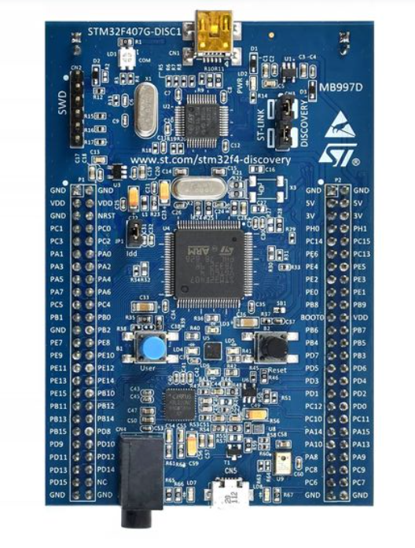

# Door Lock Indication System — AUTOSAR

## Project Overview

This project demonstrates the development of a Door Lock Indication System using the AUTOSAR architecture and an OSEK/VDX-based Operating System environment.

The project focuses on understanding how AUTOSAR Software Components (SWCs) interact through the Runtime Environment (RTE), and how application Runnables are integrated with OS Tasks.

The implementation was developed for the **STM32F4Discovery** board.

## System Overview



## Project Objectives

- Understand the AUTOSAR layered architecture.
- Design and configure Software Components (SWCs).
- Define communication interfaces between software components.
- Generate RTE files using ARTOP.
- Understand the relationship between Runnables and OS Tasks.
- Integrate generated RTE interfaces into the application.
- Gain practical experience with an AUTOSAR-based development environment.

## System Architecture

The project follows the AUTOSAR architecture, separating application functionality from the underlying software infrastructure.

The main architectural elements include:

- **Application Software Components (SWCs):** Implement the application-level functionality.
- **Runtime Environment (RTE):** Provides communication mechanisms between software components and connects application components to the underlying software.
- **OSEK/VDX OS:** Provides task-based execution and scheduling services.
- **Hardware:** STM32F4Discovery development board.


## AUTOSAR Software Components

The application is organized into software components with defined responsibilities and communication interfaces.

The components are described and configured using the AUTOSAR authoring environment.

## ARXML Configuration and RTE Generation

ARTOP was used to configure the AUTOSAR model and generate the required RTE files.

The generated files provide the interfaces required by the application software components.


## Runnable-to-OS Task Mapping

An important part of this project was manually integrating the generated RTE Runnables into the corresponding OS Tasks.

This mapping was performed manually by adding the appropriate Runnable function calls to the OS Task implementations.

This step demonstrates how AUTOSAR application-level execution is connected to the operating system's task-based scheduling.


## Implementation and Integration

The implementation process involved:

1. Configuring the AUTOSAR software components.
2. Defining the required interfaces and communication relationships.
3. Generating the RTE files using ARTOP.
4. Integrating the generated RTE files into the application.
5. Manually mapping the Runnables to their corresponding OS Tasks.
6. Building and debugging the project for the STM32F4Discovery board.

## Build and Debugging

The project includes build scripts and the required project configuration files used during development.


## Tools and Technologies

- **Microcontroller Board:** STM32F4Discovery
- **Architecture:** AUTOSAR
- **Operating System:** OSEK/VDX-based OS environment
- **AUTOSAR Authoring Tool:** ARTOP
- **Configuration Format:** ARXML
- **Runtime Environment:** Generated RTE
- **Programming Language:** C
- **Development Environment:** Keil

## Repository Structure

```text
03_Door_Lock_Indication/
├── README.md
├── mdImages/
│   ├── KEIL.png
│   ├── SRTE 2.png
│   ├── Generation RTE Generation.png
│   ├── Runnable-to-Task Mapping.png
│   ├── STM32F4Discovery.png
│   └── System Architecture.png
└── OS_DoorLock_Project/
    ├── AUTOSAR_implementation/
    ├── build/
    ├── Project_Solution/
    ├── LearnInDepth_SW/
    ├── build.py
    └── make.py
```

## Learning Outcomes

Through this project, I gained practical experience in:

- Working with the AUTOSAR software component model.
- Configuring software components and communication interfaces.
- Generating and integrating RTE files.
- Understanding the connection between Runnables and OS Tasks.
- Manually integrating application Runnables into OS Task implementations.
- Working with an AUTOSAR-based embedded software development environment.

## Acknowledgment

This project was developed as part of my practical learning in AUTOSAR and embedded software development.
