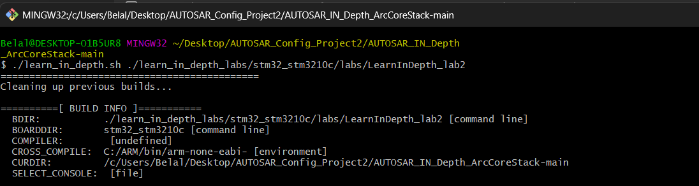
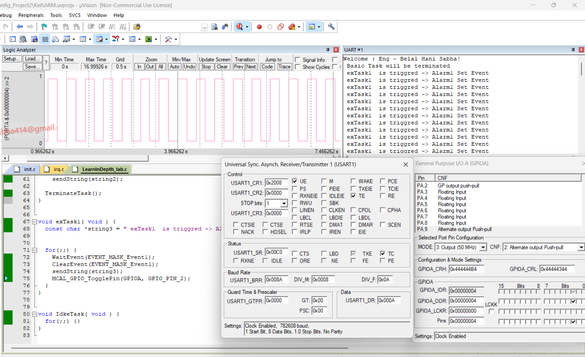

# AUTOSAR Configuration Project 2 — ArcCore Stack

## Project Overview

This project focuses on exploring and configuring an AUTOSAR-based Operating System using the ArcCore AUTOSAR Stack.

The main objective is to gain practical experience with AUTOSAR OS configuration, understand the configuration and build workflow, and investigate how the configured system can be simulated and debugged using Keil.

The project uses the **STM32F103C8T6** microcontroller as its target platform.

## Project Objectives

- Explore the structure of the ArcCore AUTOSAR Stack.
- Understand AUTOSAR OS configuration and its parameters.
- Work with the OS configuration tools.
- Understand the relationship between configuration files and generated source code.
- Build the project using the ARM GCC toolchain.
- Simulate and investigate the system using Keil.
- Gain practical experience with embedded OS configuration and debugging.

## Project Environment

| Component | Description |
|---|---|
| AUTOSAR Stack | ArcCore AUTOSAR Stack |
| Microcontroller | STM32F103C8T6 |
| Configuration Format | ARXML |
| Programming Language | C |
| Compiler | GNU Arm Embedded Toolchain |
| Development Environment | Windows / Git Bash |
| Simulation and Debugging | Keil µVision |

## AUTOSAR OS Configuration

A major part of this project is understanding how the AUTOSAR Operating System is configured through the available configuration tools.

The configuration process defines the required OS objects and parameters, which are then used as part of the project generation and build workflow.


## Build Process

The project includes a build workflow that processes the required configuration and source files to produce the embedded software output.

The build process was explored using the provided project scripts and the ARM GCC toolchain.

### Build in Progress



### Build Completed


## Keil Simulation

After building the project, Keil µVision was used to simulate and investigate the system behavior.



## Development Workflow

The general workflow explored in this project includes:

1. Exploring the ArcCore AUTOSAR Stack structure.
2. Understanding the available OS configuration tools.
3. Working with the required configuration parameters.
4. Preparing the project for building.
5. Building the project using the available toolchain.
6. Investigating the build output.
7. Opening and simulating the project in Keil.

## Tools and Technologies

- **AUTOSAR Stack:** ArcCore
- **Microcontroller:** STM32F103C8T6
- **Configuration:** AUTOSAR OS Configuration
- **Configuration Format:** ARXML
- **Programming Language:** C
- **Compiler:** GNU Arm Embedded Toolchain
- **Simulation and Debugging:** Keil µVision
- **Development Environment:** Windows / Git Bash

## Repository Structure

```text
04_AUTOSAR_Configuration_Project2/
├── README.md
├── md/
│   ├── OS Configuration.png
│   ├── Build.png
│   ├── build done.png
│   └── Keil_Sim.png
└── AUTOSAR_IN_Depth_ArcCoreStack-main/
    ├── learn_in_depth_labs/
    ├── autosar/
    ├── os/
    ├── com/
    ├── ioc/
    ├── goil/
    ├── make/
    ├── libraries/
    ├── tool/
    └── learn_in_depth.sh
```

## Learning Outcomes

Through this project, I gained practical exposure to:

- The structure of the ArcCore AUTOSAR Stack.
- AUTOSAR OS configuration workflows.
- Configuration-driven embedded software development.
- Building embedded software using the ARM GCC toolchain.
- Understanding build results and investigating build issues.
- Simulating and debugging embedded software using Keil µVision.

## Acknowledgment

This project is part of my practical learning journey in AUTOSAR and embedded software development.
